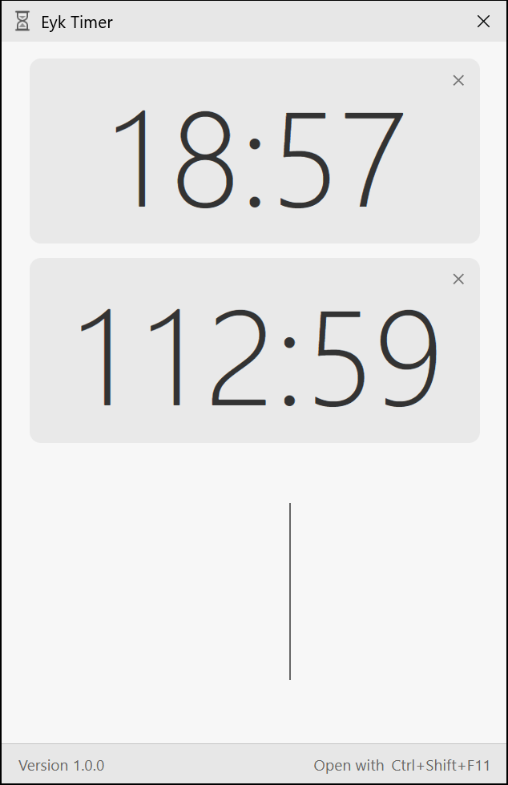

# Eyk / Timer



Open the timer, enter minutes and press Enter. The countdown runs in the background and alerts you when time is up. Use the displayed shortcut or the hourglass in the notification area to reopen it. **Ctrl+Q** exits and stops all timers.

The GitHub installer built from this checkout sets up **Ctrl+Shift+F11** to open the timer even when it is closed, with **Ctrl+Shift+F10** as a fallback. In the published 1.0.2 builds and the Store MSIX, the app registers the shortcut when it starts.

[Microsoft Store](https://apps.microsoft.com/detail/9NB0MX0C29KT) · [GitHub Releases](https://github.com/eyk/timer/releases/latest) · [Website](https://eyk.github.io/timer/)

## Development

Tauri 2 · React · TypeScript · Rust. Requires Node.js 22+ and the [Windows Tauri prerequisites](https://v2.tauri.app/start/prerequisites/).

```sh
npm ci
npm run desktop
```

[Specification](docs/SPEC.md) · [Architecture](docs/ARCHITECTURE.md) · [Tests and Windows packaging](store/README.md)

[MIT](LICENSE) · Walter Seethaler
